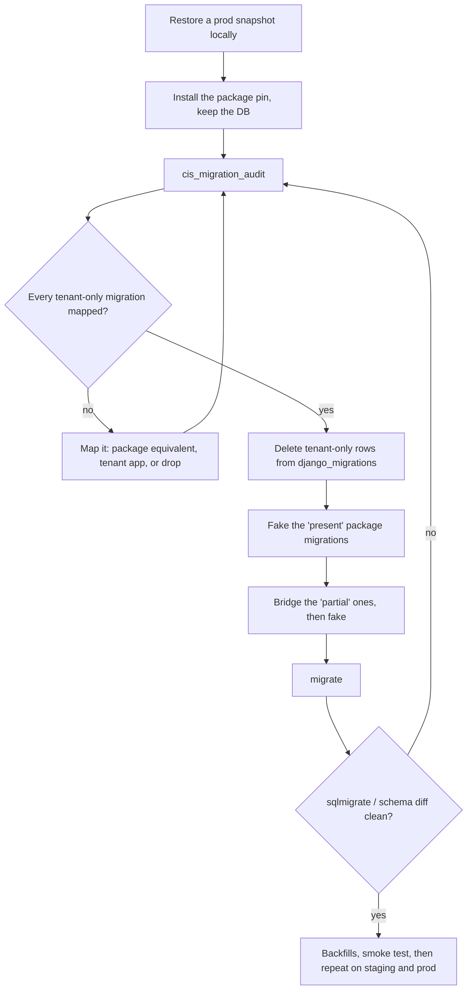

# Moving a drifted tenant onto package-cis migrations

For a tenant whose in-tree `webapp/cis` migrations split from the package's: nnu,
westmoreland, csn, weber and wvup. Their `cis` migrations match the package up to
some number and then diverge. When the tenant adopts the package, `django_migrations`
has to describe the **package's** history, and the database schema has to match it.

The package does not squash, renumber or `replaces=` its migrations. Every tenant
already on the package has the exact package history, and changing it would break them.
The bridge is therefore done once per drifted tenant, with a read-only audit command and
the runbook below.

## The audit command

```bash
python manage.py cis_migration_audit
```

It changes nothing. It prints:

- **Tenant-only cis migrations recorded:** rows in `django_migrations` for app `cis`
  that the package doesn't have, such as nnu's `0058_student_current_state_balance`.
- **Package cis migrations not applied**, each with a verdict from the live schema:

| Verdict | Meaning | Action |
|---|---|---|
| `present` | Every table and column it adds already exists | `migrate cis <name> --fake`, after checking types and nullability match |
| `missing` | Nothing it adds exists | Leave it for `migrate` |
| `partial` | Some of it exists | Write a one-off SQL bridge, then `--fake` |
| `review` | It alters, removes or renames something, or runs code | Read the migration and decide |
| `no-op` | Choices or help text only | Nothing to check; `migrate` records it |

Run the command with the **package** installed, so the package's migration files are on
disk, against a **restored copy** of the tenant database.

## Runbook



1. **Restore a production snapshot** into a local database. Never rehearse against
   production.
2. **Switch the code to the package** (remove the in-tree `webapp/cis`, pin
   `myce_cis`), but don't run `migrate` yet.
3. **Run `cis_migration_audit`** and save the output.
4. **Map every tenant-only migration** to one of:
   - a package migration that does the same thing (it will show as `present`);
   - a field the package now models, such as nnu `0058` → package `0114`, or nnu `0061`
     → package `0113`. These are written field for field the same, so they fake cleanly;
   - something that moves to a tenant-owned app (nnu `0072`, the SDE verification group);
   - something the tenant drops at cutover. For example, nnu's `HighSchool.is_consortium`:
     the package models consortiums as `Consortium` / `ConsortiumMembership`, so nnu
     turns the flag into memberships and drops the column;
   - choices-only, so nothing needs to happen in the database (nnu `0056`, `0057`,
     `0062`, `0064`, `0071`).
5. **Delete the tenant-only rows**, after checking the list one last time:

   ```sql
   DELETE FROM django_migrations WHERE app = 'cis' AND name IN ('0058_…', …);
   ```

6. **Fake the `present` migrations** in order: `python manage.py migrate cis <name> --fake`.
   Before faking, compare the column types and `NULL`/default behaviour with the
   migration (`sqlmigrate cis <name>`).
7. **Bridge the `partial` ones.** Write the SQL that adds what is missing, run it, then
   fake the migration.
8. **Run `migrate`.** Only the `missing`, `review` and `no-op` migrations are left.
9. **Check the result.** `makemigrations cis --check` is clean, and a schema diff
   against a fresh database built from the package migrations shows no difference in
   `cis_*` tables.
10. **Run tenant backfills**, then a smoke test of the CE, student and HS-admin portals.
11. **Repeat** on staging, then production, with the exact script the rehearsal produced.

## Notes

- A `NOT NULL` column without a database default that only the tenant has (nnu's
  `current_state_balance` before 0114, `is_consortium`) makes every insert through the
  package model fail. Model it upstream with a default, or drop it at cutover. Never
  leave it in place.
- Rows the package's data migrations would have written (`RunPython`, shown as `review`)
  may already exist in a different form. Read each one: some are safe to run twice, some
  aren't.
- `0056` depends on the `ethos` app only when it is installed; see the README for
  tenants without ethos.
- Data a tenant-only migration changed may need changing back. nnu's `0066` renamed the
  `import_student_id_from_ethos` CronTab row to `import_student_id`; the package's command
  and setting use the `import_student_id_from_ethos` name, so rename the row back. nnu's
  own S3 import then plugs in as `services/student_id_import.py` (#93).
